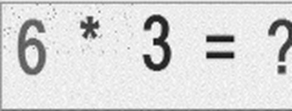
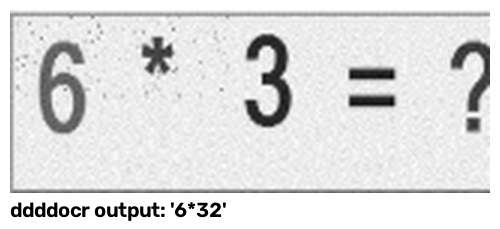
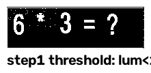
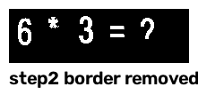
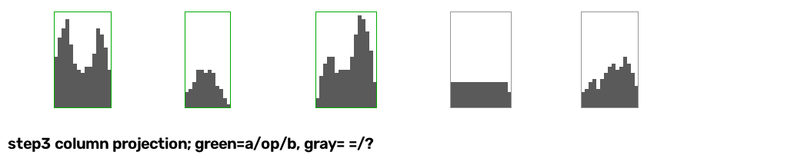
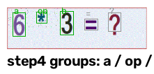
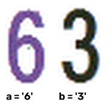

# 验证码识别流程图解

用一张真实样本（`captcha_samples/collect_20261105_131511.png`，题目 `6 * 3 = ?`）逐步展示两个算法的中间结果。

- **v1（整串 OCR）** 输出 `'6*32'` —— **错误**（会算出 192）
- **v2（分割 + 几何判别）** 输出 `'6*3'` —— 正确

> 所有图由 `visualize_captcha.py` 生成，可对任意样本复现：
> ```bash
> uv run visualize_captcha.py captcha_samples/collect_20261105_131511.png
> ```
> 图片位于 `docs/captcha_pipeline/`。

---

## 一、v1：整串 OCR（ddddocr + 白名单 + 正则）

### Step 1 原图


彩色实色字形（`6` 紫、`*` 青、`3` 深蓝、`=` 红、`?` 紫）+ 大量彩色/灰色噪点，四周有一圈彩色边框。

### Step 2 灰度化


`Image.convert("L")` 丢掉颜色信息。对通用 OCR 模型来说这一步是常规预处理，但也意味着**整个流程不再利用"字色"这一强特征**。

### Step 3 右侧裁掉 20%


固定裁到宽度 80%，意图是去掉尾部 `=?`。风险在于：`?` 的实际位置随布局浮动，这一步**只裁掉了 `?` 的大部分，右侧仍残留一部分**。

### Step 4 放大 3 倍



LANCZOS 放大 3 倍，让细笔画（尤其 `*`）更明显，再交给 ddddocr（其内部会再缩放到高 64 识别）。

### Step 5 识别结果：`'6*32'` —— 错误



两个问题叠加：

1. **尾部污染**：残留的 `?` 被读成数字 `2`，粘在 `3` 后面 → `32`；
2. **运算符合成**：`*` 勉强识别对了，但 `6*32` 会被算成 192（错误答案），而且流程不会报错——**静默算错**。

在 1010 张样本上，v1（修正白名单后）可解析率 85.9%，30 张标注准确率 80%，错误全部集中在乘法题（`*` 漏识）与尾部污染。

---

## 二、v2：分割 + 运算符几何判别

实现见 `captcha_ocr.py`。核心思想：**不要求通用模型去认运算符**，而是利用"格式固定 + 字形规整"这两个已知条件。

### Step 1 原图

同 v1。

### Step 2 前景阈值（亮度或饱和度）



规则：`亮度 < 180`（深色字形）**或** `饱和度 > 60`（彩色字形）判为前景。

这样做是因为样本中字形颜色分布很广：有的深蓝近黑（亮度 ~60），有的亮粉（饱和度 ~100）；而背景亮度约 240。此图里边框还在，所以四周是白框——直接做列投影会把整张图连成一片，所以下一步必须先去掉边框。

### Step 3 去边框 + 噪点过滤



1. 把图像四周 2px 置零（去彩色边框）；
2. 对二值图做连通域分析，只保留 `面积 >= 30` 且 `宽或高 >= 8` 的连通域。

彩色小噪点（面积 10~25、宽高 4~5）在这一步被清除，而字形笔画（宽 9~17、高 24~31、面积 120~300）全部保留。

### Step 4 列投影分组



每个柱子的高度 = 该列前景像素数。空白列（无前景）把图像切成若干段：

- **数字内部**的字间距只有 1~6px；
- **组与组之间**（含运算符两侧）间距约 18~23px。

因此"段间距 ≤ 10px 就合并"：`6`、`*`、`3`、`=`、`?` 五组清晰分开（绿色 = 保留的前三组，灰色 = 丢弃的 `=`、`?`）。

关键收益：**尾部 `=`、`?` 在结构上被整组丢弃**，不再有"`?` 被读成数字粘到答案后面"的问题。

### Step 5 分组框



按固定格式 `a op b = ?`，直接取前三组作为 `a` / `op` / `b`，后两组丢弃。即使 `?` 因颜色太浅没被检出（分组只有 4 组），也不影响——只需要前三组。

### Step 6 运算符几何判别


对 `op` 组只量两个数：**宽 w、高 h**。

| 运算符 | 实测宽 | 实测高 | 判别规则 |
|---|---|---|---|
| `-` | 9~12 | 4~7 | `h <= 7 且 w <= 13` |
| `+` | 15~18 | 18~21 | `w >= 14 且 h >= 16` |
| `*` | 9~13 | 8~15 | `w <= 13 且 8 <= h <= 15` |
| `/` | 窄而高 | — | `h >= 16 且 w <= 13`（落在 `*` 与 `+` 之间的空档） |
| `÷` | 一横+两点 | — | 原始掩码连通域 ≥3 且有扁长横杠 |
| 其他未知 | — | — | 抛错，按识别失败处理（刷新重试后跳过当天） |

本样本 `w=12 h=13` → `'*'`。30 张标注样本的运算符判别 **30/30 全对**。

> 除法在页面上可能渲染成 `/` 或 `÷`，两种都已按除法处理：
> - `/` 是单连通域的窄高斜线，用“高 ≥16 且宽 ≤13”兜底；
> - `÷` 的两个点在去噪时会被删掉、只剩横杠，所以先看**未过滤的原始掩码**：有 3 个以上连通域且含扁长横杠，即判为 `/`。
>
> 两种规则都不命中时才抛错，交给上层的「刷新验证码重试 3 次 → 跳过当天」流程，绝不静默算错。

### Step 7 数字识别



`a`、`b` 两组各自裁剪：

1. 用前景 mask 把背景像素置白（去掉残留噪点）；
2. 放大 4 倍；
3. 交 ddddocr 单独识别，字符集限制为 `0-9`。

相比"整串识别"，这里每次只需认 1~2 个干净数字，且没有运算符/`=?` 干扰，识别率接近 100%。

### Step 8 输出：`'6*3'` —— 正确

`a='6'`、`op='*'`、`b='3'` → 表达式 `6*3` → 计算得 `18`。

---

## 三、参数速查

| 参数 | 取值 | 作用 |
|---|---|---|
| 输入归一化 | 统一缩放到 `201×61` | 抵消截图缩放/DPR 差异，保证下方像素阈值有效 |
| 亮度阈值 | `< 180` | 深色字形入前景 |
| 饱和度阈值 | `> 60` | 彩色字形入前景 |
| 边框裁剪 | 2px | 避免列投影被边框连成一片 |
| 连通域过滤 | 面积 ≥30 且 (宽 ≥8 或 高 ≥8) | 去彩色噪点 |
| 分组合并间距 | ≤ 10px | 合并两位数、切分运算符 |
| 运算符判别 | `h≤7 且 w≤13` → `-`；`w≥14 且 h≥16` → `+`；`w≤13 且 8≤h≤15` → `*`；`h≥16 且 w≤13` → `/`；原始掩码 ≥3 连通域 → `/`；其余拒绝 | 几何分类；除法兼容 `/` 与 `÷` |

## 四、评测结果（详见 CAPTCHA_EVAL.md）

| 版本 | 可解析率（1010 张） | 标注准确率（30 张） |
|---|---|---|
| v1 | 85.9% | 80.0% |
| v2 | **99.8%**（仅 2 张无效占位图失败） | **100%** |