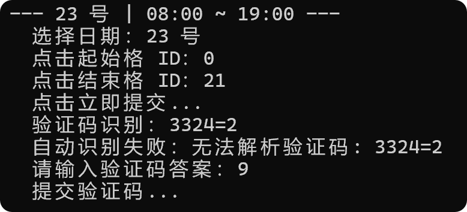

# 仪器预约自动脚本 使用说明

基于 Playwright 的 WebVPN 仪器预约自动化工具：自动登录 → 搜索仪器 → 按工作日批量预约，并用 OCR 自动识别验证码。

---

## 一、环境准备

以下命令均为 **Windows（PowerShell）** 环境，在**本项目根目录**下执行。

需要 **Python 3.13**（不用自己装，uv 会自动下载）。

### 用 uv 安装

```powershell
# 1. 安装 uv（只需一次）：https://uv.doczh.com/getting-started/installation/
# 2. 安装依赖并运行：
uv python install 3.13              # 本机已有 Python 3.13 可跳过
uv sync                             # 创建 .venv 并安装全部依赖
uv run playwright install chromium  # 首次必装浏览器内核（下载 Chromium，较慢）
uv run python reserve.py            # 运行脚本
```

- `playwright`：浏览器自动化核心
- `ddddocr`：验证码自动识别

### Chromium 下载慢 / 卡住？

Chromium 内核由 Playwright 从**官方 CDN** 下载，**不走** uv 的清华镜像（那只管 Python 包）。国内直连慢或卡住时，二选一：

**方式 A：临时挂本地代理**（如 Clash 默认端口 7890，仅当前 PowerShell 窗口有效）：

```powershell
$env:HTTP_PROXY  = "http://127.0.0.1:7890"
$env:HTTPS_PROXY = "http://127.0.0.1:7890"
uv run playwright install chromium
```

**方式 B：换 npmmirror 国内镜像**（不需要代理）：

```powershell
$env:PLAYWRIGHT_DOWNLOAD_HOST = "https://cdn.npmmirror.com/binaries/playwright"
uv run playwright install chromium
```

> 注意：代理/镜像只在**下载浏览器内核这一次**用。日常运行脚本访问的是学校 WebVPN，请勿挂代理跑 `reserve.py`。

---

## 二、配置文件

所有配置都在本目录的 **`config.ini`** 中（仓库自带模板，克隆后直接改这个文件）。**填入真实学号密码后请不要再把该文件提交回 git**，防止泄露。完整格式如下，按需修改：

```ini
[account]
student_id = 你的学号
password = 你的密码

[instrument]
index = 1

[time]
start_range = 8,9
end_range = 18,23
monthly_budget = 200

[date]
start_day =
end_day =
```

> ⚠️ 首次使用前先打开 `config.ini` 把学号密码填好；留空脚本会直接报错退出。

### 选择仪器

把 **`[instrument] index`** 填成下表中的设备序号：

| 序号 | 仪器名称 | 备注 |
|---|---|---|
| 1 | 通信场景仿真攻防对抗实验教学设备 | |
| 2 | 可重构高性能无损网络实验教学设备 | S2507234 |
| 3 | 可重构高性能无损网络实验教学设备 | S2507235 |
| 4 | 可编程SDN网络技术实验教学设备 | |
| 5 | 5G-A通感一体化网络实验教学设备 | |

> ⚠️ 2、3 是**同名**的两台不同设备，确认后再填；留空或越界脚本会报错退出。

### 参数说明

| 配置项 | 含义 | 默认值 |
|---|---|---|
| `[account] student_id` | 登录学号（**必填**，留空脚本直接报错退出） | 空 |
| `[account] password` | 登录密码（**必填**，留空脚本直接报错退出） | 空 |
| `[instrument] index` | 要预约的设备序号（**1-5**，见上方设备列表），必填 | `1` |
| `[time] start_range` | 开始时间随机区间（小时），格式「起,止」 | `8,9` → 08:00~09:00 |
| `[time] end_range` | 结束时间随机区间（小时），格式「起,止」 | `18,23` → 18:00~23:00 |
| `[time] monthly_budget` | 当月预约总时长上限（小时） | `200` |
| `[date] start_day` | 开始日期（当月几号）；留空=运行时询问 | 空 |
| `[date] end_day` | 结束日期（当月几号）；留空=运行时询问 | 空 |

时间以 **半小时** 为粒度；若总时长超出上限，脚本会自动从最长的那天往前收结束时间。仪器列表（含重名设备的区分策略）固定在 `reserve.py` 内，一般无需改动。

---

## 三、运行步骤

```powershell
uv run python reserve.py
```

启动后是**交互式向导**，全程如下：

1. **开始/结束日期**：默认从当月第一个工作日起、到月底（只约周一~周五，自动跳过周末）。直接回车确认，或改成当月的几号就输入几（如 `20`）。
2. **计划预览与确认**：列出每天日期、星期、时间段、时长；回车执行，输入 `n` 取消。
3. **自动执行**：打开浏览器 → 登录 → 搜索仪器 → 自主上机 → 逐天选日期/时间/提交，验证码自动 OCR 识别填入。页面无需你点，只需看着。
4. **结束**：按终端提示回车关闭浏览器。

只有两种情况需要你人工介入（终端会打印暂停原因，按提示做即可，不会崩溃）：

- 验证码识别失败 / 图片太糊 → 在**终端**输入验证码答案，回车后脚本帮你填进浏览器；
- 某步自动点击没生效 → 在浏览器里手动完成该步，**回车**继续。

> 🛑 每个工作日**只提交预约一次**，提交成功后请勿再点「提交」，以免重复预约。

---

## 四、注意事项

- **首次运行建议只约 1 天试水**，确认「选日期 → 选时间 → 勾选 → 提交 → 过验证码」整条链路走通，再放开全月。
- 开始日期是**当天**时，已过去的时间格选不了：起始时间会自动顺延到「当前时间 + 1 小时」之后；若当天的起始区间（默认早上 8~9 点）已整体过去，则**自动跳过当天**、从下一个工作日开始。
- 脚本**不会检测当天是否已预约**，若与已有预约冲突可能导致提交失败（失败日期会打印在末尾）。

### 验证码识别失败的示例

当验证码带有干扰线、噪点或字符粘连时，OCR 容易识别错误，脚本会回退为在**终端手动输入**，属正常现象，不影响整体预约：



---

## 五、常见问题

| 现象 | 原因 / 处理 |
|---|---|
| `uv` / `playwright` 报错找不到浏览器 | 没执行 `uv run playwright install chromium`，补装即可 |
| Chromium 下载很慢 / 卡住 | 见「一、环境准备 → Chromium 下载慢 / 卡住？」：挂本地代理或换 npmmirror 镜像 |
| 验证码一直要手动输入 | `ddddocr` 没装好，或验证码太复杂；不影响使用，手动填即可 |
| 约错了仪器 | `config.ini` 的 `index` 填错了，按第二节编号表改对后重跑 |
| 日期选不中 | 检查 `reserve.py` 中 `td[onclick*="YYYY-MM-DD"]` 日期格式是否与页面一致（零补齐） |
| 整月某天失败 | 脚本会把失败日期打印在末尾 `失败日期：[...]`，可单独重跑那天 |

---

## 六、其他文件

- `reserve.py`：主脚本，正常预约只用它（走 WebVPN，任何能上网的环境都能跑，不需要校园网）。
- `config.ini`：配置文件（仓库自带模板；本地填好账号密码后，勿将真实值提交回 git）。
- `pyproject.toml` / `uv.lock`：依赖声明与版本锁，`uv sync` 用（下载源已默认设为清华镜像）。
